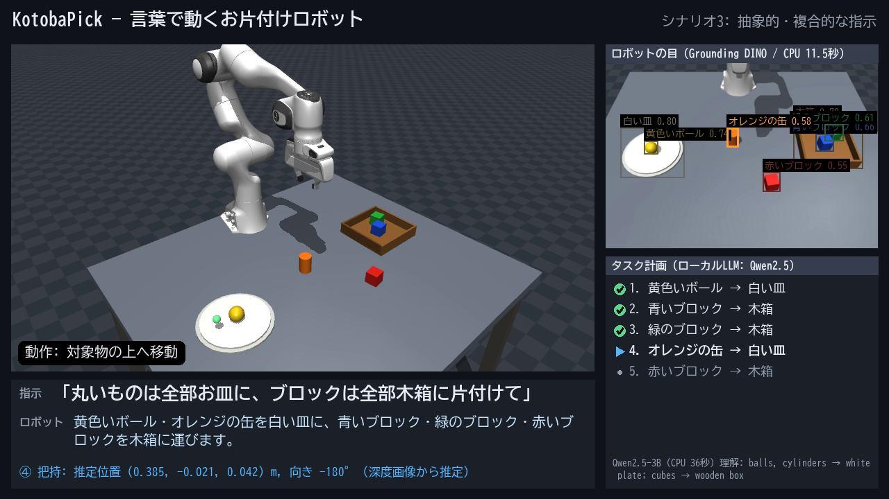

# KotobaPick — 言葉で動くお片付けロボット

Physical AI 応用1講座 最終課題「AI×ロボティクスによる創造的タスクの実現」の提出コードです。

日本語の指示（例:「丸いものは全部お皿に、ブロックは全部木箱に片付けて」）を受けて、
MuJoCo 上の Franka Panda ロボットアームが机の上の物体を認識・計画・把持・配置します。
AI モデルはすべて **ローカル PC の CPU だけ**で動き、GPU やクラウド API は使いません（いずれも推論のみ）。

- デモ動画: （YouTube の URL をここに記載）
- 説明資料: `docs/report.pdf`



## 何をするか

| 段階 | 手法 | 使用 AI |
|---|---|---|
| ① シーン認識 | RGB-D カメラ画像から物体を検出し、深度で 3D 位置・上面高さ・向きを推定 | **Grounding DINO tiny** (オープン語彙物体検出) |
| ② タスク計画 | 指示を「何を → どこへ」の規則に構造化。名前で照合できない説明句（「一番左のもの」等）は各物体が当てはまるかを yes/no で判定 | **Qwen2.5-3B-Instruct** (ローカル LLM) |
| ③ 再認識 | 各手順の直前に対象と置き場所をカメラで探し直す（見失ったら再度探す） | Grounding DINO |
| ④⑤ 把持・配置 | 減衰最小二乗法 IK + 最小躍度軌道。容器内は空いている場所を選んで置く | — |
| ⑥ 結果確認 | 置けたかを位置と高さで画像から検証。把持失敗・搬送中の落下はグリッパ開度で検知し再試行 | Grounding DINO |
| ⑦ 最終確認 | 全手順の終了後に、成功した手順の結果をもう一度画像で確認 | Grounding DINO |

**AI とシミュレータ内部情報の使い分け**: 通常の実行では、対象物の位置・向きは RGB-D 画像から推定し、
シミュレータが持つ物体の真値は使いません。真値を使うのは、シーンの生成・デモの外乱の注入（外乱の検知と回復はロボットが自律的に行う）・
評価スクリプトでの精度計測だけです。LLM に渡すのは画像ではなく、認識結果の物体リスト（ラベルと大まかな位置）と指示文です。
把持・配置の動作、置き場所の候補、実行順序の決め方はプログラムで定義しています。

## 工夫した点（詳細は説明資料）

1. **検出器の比較と候補語の工夫**: OWLv2 は色の識別が弱かったため Grounding DINO を採用。候補語をまとめて
   「競わせる」問い合わせ方にし、紛らわしい語（green cylinder 等）を候補から外して誤ラベルをなくした。
2. **小型 LLM を確実に使うための問題分解**: 一度に「理解」と「当てはめ」をさせると誤りが多かったため、
   「指示 →（何を, どこへ）の規則」への構造化と、説明句と物体の照合に分けた。照合は、名前で決まるものはプログラム、
   位置など名前だけでは決まらないものだけ LLM の yes/no 判定に任せる。
   一部の対象が見つからない場合はその旨を表示して残りだけ実行し、何も見つからない・計画が不正な場合は動かずに報告する。
3. **閉ループ**: 各手順の直前に再認識し、置いた後は位置と高さで成否を確認。全手順の後にも最終確認する。
4. **AI の考えが見える動画**: 検出結果・LLM の理解と計画・推定把持位置・処理段階を 1 画面に表示（推論時間も明示）。
5. **PC を汚さない**: 依存パッケージはプロジェクト内の仮想環境、モデルは既定で `./.cache/` に保存。

## 動作環境

- Windows 11 / Python 3.10 / Git で動作確認（CPU: Core i7-1185G7, RAM 16GB, GPU なし）
- 動画の日本語表示に Windows 標準フォント（BIZ UDゴシック等）、説明資料の PDF 化に Microsoft Edge を使用
- 初回実行時に学習済みモデル（合計 約 7GB）を Hugging Face から取得します。保存先は既定で `./.cache/huggingface/`
  （環境変数 `HF_HOME` が設定済みの場合はそちらを使います）。
- Qwen2.5-3B を bf16 で読み込むため、空きメモリが 7〜8GB 程度必要です。

## セットアップ（PowerShell）

```powershell
python -m venv .venv
.\.venv\Scripts\python.exe -m pip install torch==2.14.1 torchvision==0.29.1 --index-url https://download.pytorch.org/whl/cpu
.\.venv\Scripts\python.exe -m pip install -r requirements.txt
.\.venv\Scripts\python.exe scripts\setup_assets.py
```

`setup_assets.py` は Franka Panda のモデル（MuJoCo Menagerie）を `third_party/` に git で取得します。

## 実行

```powershell
# デモ動画を生成 (outputs\kotoba_pick_demo.mp4 と実行ログ .json)。CPU で 30〜60 分程度かかります
.\.venv\Scripts\python.exe scripts\run_demo.py

# LLM を使わず固定計画で動作確認 (速い)
.\.venv\Scripts\python.exe scripts\run_demo.py --scenarios 1 --fake-llm

# 評価
.\.venv\Scripts\python.exe scripts\eval_perception.py --seeds 10
.\.venv\Scripts\python.exe scripts\eval_planner.py --model Qwen/Qwen2.5-3B-Instruct --mode decompose
.\.venv\Scripts\python.exe scripts\compare_detectors.py
```

## ファイル構成

```
kotoba_pick/
  scene.py       シーン構築 (Panda + テーブル + 物体 + 容器 + カメラ)
  robot.py       IK・軌道生成・把持/配置プリミティブ
  perception.py  Grounding DINO による検出 + 深度からの 3D 位置・向き推定
  planner.py     ローカル LLM による計画 (分解方式 / 比較用の一括生成・候補採点方式)
  pipeline.py    認識→計画→(再認識→把持→配置→確認)→最終確認 の閉ループ実行
  video.py       動画合成 (AI の内部状態を重ねて表示)
  diagram.py     システム構成図
scripts/
  run_demo.py          5 シナリオのデモ動画を生成
  eval_perception.py   認識精度の評価
  eval_planner.py      計画正解率の評価
  compare_detectors.py 検出器の比較図
  setup_assets.py      ロボットモデルの取得
  build_report.py      説明資料 (HTML → PDF)
docs/                  説明資料と図
```

## 制約・既知の限界

- シミュレーションのみ（実機では未検証）。物体は単色の単純形状で、深度画像にノイズはありません。
- 同じラベルの物体は 1 個として扱います（同色・同形の物体が複数ある場面は未対応）。
- 把持は真上からのみ。経路の衝突検査はなく、IK の残差も確認していません。
- 閉ループは手順単位（動作中の視覚フィードバックはなし）。CPU 推論のため 1 回の認識に約 15 秒かかります。

## クレジット・ライセンス

- ロボットモデル: [MuJoCo Menagerie](https://github.com/google-deepmind/mujoco_menagerie) Franka Emika Panda (Apache-2.0)
- シミュレータ: [MuJoCo](https://github.com/google-deepmind/mujoco) (Apache-2.0)
- 物体検出: [Grounding DINO tiny](https://huggingface.co/IDEA-Research/grounding-dino-tiny) (Apache-2.0)
- LLM: [Qwen2.5-3B-Instruct](https://huggingface.co/Qwen/Qwen2.5-3B-Instruct)（Qwen Research License: 非商用の研究・学習目的で使用）、
  比較実験に [Qwen2.5-1.5B-Instruct](https://huggingface.co/Qwen/Qwen2.5-1.5B-Instruct)（Apache-2.0）
- 比較実験の検出器: [OWLv2](https://huggingface.co/google/owlv2-base-patch16-ensemble) (Apache-2.0)
